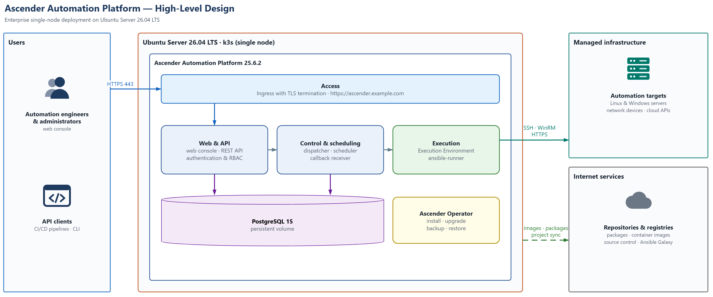
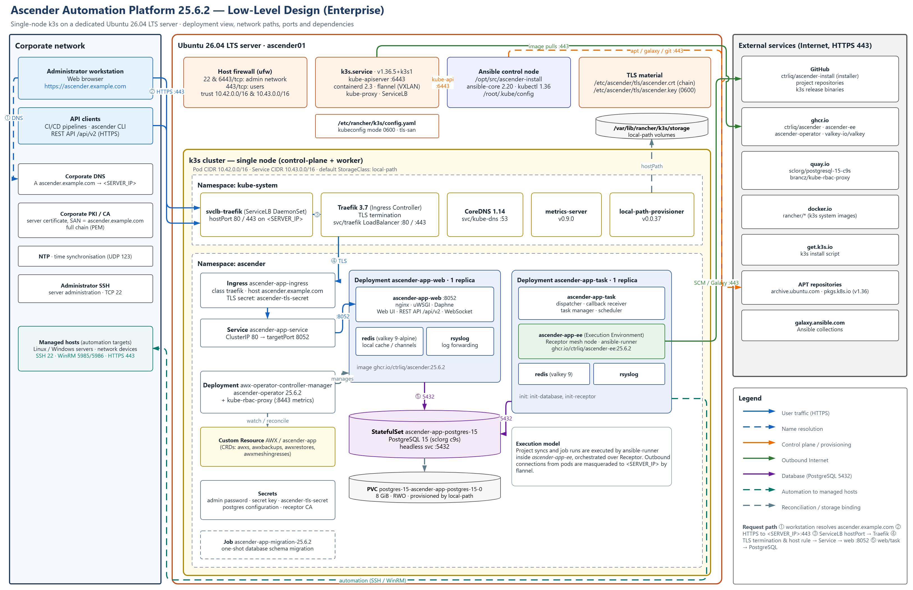
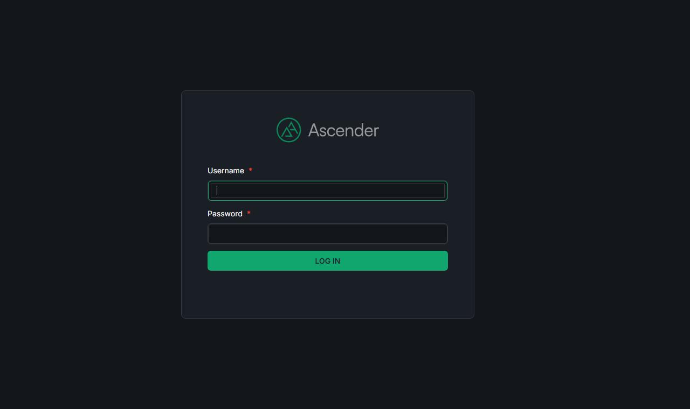

# Ascender Automation Platform — Enterprise Installation Guide

End-to-end procedure to build an **Ascender 25.6.2** automation controller on a dedicated **Ubuntu Server 26.04 LTS** host in a corporate environment: server baseline, DNS and TLS certificate, every software dependency, Kubernetes (**k3s**), host firewall, the installation run, its verification, first access over HTTPS and day-2 operations.

| | |
|---|---|
| **Validated release** | Ascender 25.6.2 · `ascender-install` @ `a737ea8` · k3s `v1.36.5+k3s1` |
| **Target platform** | Ubuntu Server 26.04 LTS (x86_64), physical or virtual |
| **Topology** | Single node, HTTPS with a corporate PKI certificate |



## Contents

1. [Solution architecture](#1-solution-architecture)
2. [Introduction](#2-introduction)
3. [Prerequisites](#3-prerequisites)
4. [Software bill of materials](#4-software-bill-of-materials)
5. [Installation procedure](#5-installation-procedure)
6. [Accessing Ascender](#6-accessing-ascender)
7. [Operations](#7-operations)
8. [Troubleshooting](#8-troubleshooting)
9. [Lessons learned](#9-lessons-learned)
- [Appendix A — Configuration files](#appendix-a--configuration-files)
- [Appendix B — References](#appendix-b--references)
- [License](#license)

### Repository layout

```text
.
├── README.md                     This procedure
├── LICENSE                       MIT License (code and configuration files)
├── LICENSE-CC-BY-4.0             CC BY 4.0 (documentation and diagrams)
├── docs/
│   ├── architecture/             HLD and LLD (draw.io sources + PNG exports)
│   └── images/                   Screenshots
└── files/                        Reference copy of every file created on the server,
                                  laid out by its absolute path (etc/, opt/, usr/)
```

### Conventions

| Convention | Meaning |
|---|---|
| `bash` blocks | Commands executed on the Ascender server in a root shell (`sudo -i`). |
| `powershell` blocks | Commands executed in Windows PowerShell on an administrator workstation (verification only). |
| `<VALUE>` | Site-specific value defined in the [pre-installation worksheet](#35-pre-installation-worksheet). |
| ✅ **Expected result** | Output that confirms the step completed successfully. Do not proceed until it is met. |

---

## 1. Solution architecture

### 1.1 High-Level Design (HLD)


*Figure 1 — Ascender enterprise HLD (source: [`Ascender-Enterprise-HLD.drawio`](docs/architecture/Ascender-Enterprise-HLD.drawio))*

### 1.2 Low-Level Design (LLD)



*Figure 2 — Ascender enterprise LLD (source: [`Ascender-Enterprise-LLD.drawio`](docs/architecture/Ascender-Enterprise-LLD.drawio))*

### 1.3 Architecture summary

Figure 1 presents the logical view: who consumes the platform, the functional tiers of Ascender, the managed infrastructure and the external dependencies. Figure 2 refines it into the physical deployment on the server, including the corporate DNS, PKI and NTP services and naming every Kubernetes object, host component, port and network path.

The platform is a single-node deployment on a dedicated Ubuntu Server 26.04 LTS host. A lightweight, CNCF-certified Kubernetes distribution (k3s) runs on the server and hosts the Ascender control plane, which is deployed and lifecycle-managed by the Ascender Operator (a CIQ build of the AWX Operator). Users and API clients reach the platform over HTTPS on a corporate DNS name, with a certificate issued by the corporate PKI.

- **Host layer** — Ubuntu Server 26.04 LTS with systemd, the `ufw` host firewall, TLS material under `/etc/ascender/tls`, and the Ansible control node used by the installer.
- **Kubernetes layer** — k3s v1.36.5 with ServiceLB (publishes ports 80/443 on the server IP), Traefik (ingress and TLS termination), CoreDNS, local-path storage and metrics-server.
- **Application layer** — namespace `ascender` with the Operator, the web and task deployments, PostgreSQL 15 and its persistent volume.
- **Corporate services** — DNS, PKI/CA and NTP; managed hosts are reached from the execution tier over SSH, WinRM or HTTPS.

### 1.4 Component inventory

| Component | Kubernetes object / host unit | Responsibility |
|---|---|---|
| Web tier | Deployment `ascender-app-web` (containers: `ascender-app-web`, `redis`, `rsyslog`) | Web UI, REST API (`/api/v2`), WebSocket; served by nginx, uWSGI and Daphne on port 8052. |
| Task tier | Deployment `ascender-app-task` (containers: `ascender-app-task`, `ascender-app-ee`, `redis`, `rsyslog`) | Dispatcher, task manager, scheduler, callback receiver; `ascender-app-ee` runs Receptor and ansible-runner. |
| Database | StatefulSet `ascender-app-postgres-15`, headless Service `:5432` | PostgreSQL 15 holding all Ascender state. |
| Persistent storage | PVC `postgres-15-ascender-app-postgres-15-0` (8 GiB, RWO, local-path) | Database volume under `/var/lib/rancher/k3s/storage`. |
| Operator | Deployment `awx-operator-controller-manager` | Reconciles the `AWX/ascender-app` custom resource; installs, upgrades, backs up and restores. |
| Ingress | Ingress `ascender-app-ingress` (class `traefik`, TLS secret `ascender-tls-secret`) | Routes `https://<ASCENDER_FQDN>` to Service `ascender-app-service` (80 → 8052). |
| Ingress controller | Deployment `traefik` (`kube-system`) | TLS termination and layer-7 routing (Traefik 3.7). |
| Service load balancer | DaemonSet `svclb-traefik` (k3s ServiceLB) | Publishes Traefik on ports 80/443 of `<SERVER_IP>` through hostPort DNAT. |
| Host firewall | `ufw` | Restricts inbound access to SSH and the Kubernetes API to the administration network. |
| TLS material | `/etc/ascender/tls/ascender.crt` and `ascender.key` | Corporate certificate (full chain) and private key, loaded into `ascender-tls-secret` by the installer. |
| Installer | `/opt/src/ascender-install` (Ansible) | Idempotent playbooks that deploy the Operator and Ascender and load the starter content. |

### 1.5 Network flows and ports

| # | Source → Destination | Protocol / port | Purpose |
|---|---|---|---|
| 1 | Workstations, API clients → `<SERVER_IP>` | HTTPS 443/tcp | Web console and REST API. |
| 2 | Workstations → corporate DNS | DNS 53 | Resolution of `<ASCENDER_FQDN>`. |
| 3 | ServiceLB → Traefik → web pod | 443 → 8052 (cluster-internal) | TLS termination and host-based routing. |
| 4 | Web / task pods → PostgreSQL | 5432/tcp (cluster-internal) | Application database. |
| 5 | Administration network → server | SSH 22/tcp, HTTPS 6443/tcp | Server administration; kubectl / kube-apiserver. |
| 6 | Execution tier → managed hosts | SSH 22, WinRM 5985/5986, HTTPS 443 | Automation jobs. |
| 7 | Server → Internet | HTTPS 443/tcp | Packages, container images, project repositories, Ansible Galaxy. |
| 8 | Server → NTP | UDP 123 | Time synchronisation (required for TLS and job scheduling). |

### 1.6 Design decisions

| Decision | Rationale |
|---|---|
| k3s single node (installer platform `k3s`) | Officially supported by `ascender-install`; the installer provisions the full stack unattended. For high availability the same installer supports RKE2 and managed Kubernetes services (EKS, AKS, GKE). |
| k3s defaults kept (ServiceLB + Traefik) | No custom networking is needed on a dedicated server; ServiceLB exposes Traefik on the server address. |
| HTTPS with a corporate certificate | Credentials and automation secrets travel encrypted; browsers and API clients trust the endpoint without exceptions. |
| DNS name `<ASCENDER_FQDN>` | Stable service name, independent of the server address; used for the ingress host rule, CSRF trusted origins and the certificate SAN. |
| `use_etc_hosts: true` with `<SERVER_IP>` | The installer pins the FQDN to the server address in `/etc/hosts`, so its health checks do not depend on DNS propagation. |
| Host firewall (`ufw`) following k3s guidance | Limits SSH and the Kubernetes API to the administration network while trusting the pod and service networks, as required by k3s. |
| Local-path storage | Simple and sufficient for a single node. Place `/var/lib/rancher` on a dedicated, backed-up volume where possible. |
| Ledger and Galaxy Proxy not installed | Optional components, not required for the core automation controller. |

---

## 2. Introduction

### 2.1 Purpose

This is the reference procedure to install, configure, verify and operate the Ascender Automation Platform on a dedicated Ubuntu Server 26.04 LTS host. It is written so that an engineer with no prior exposure to Ascender or Kubernetes can reproduce the deployment by following the steps in order.

### 2.2 Scope

- **In scope:** server baseline; DNS record and TLS certificate; installation of all dependencies; k3s; host firewall; the Ascender installer; post-installation verification; first access; backup, upgrade, certificate renewal and troubleshooting.
- **Out of scope:** multi-node high availability, external PostgreSQL, LDAP/SAML/OIDC integration details, air-gapped (offline) installation, Ascender Ledger and Galaxy Proxy.

### 2.3 About Ascender

Ascender is CIQ's open-source automation platform (Apache 2.0), a downstream distribution of the AWX project. It provides a web console, REST API, role-based access control, credential management, inventories, job templates, workflows and scheduling for Ansible automation.

- Source code: <https://github.com/ctrliq/ascender>
- Installer: <https://github.com/ctrliq/ascender-install>

### 2.4 Procedure overview

| Phase | Activity | Indicative duration |
|---|---|---|
| 1 | Server baseline (hostname, time, updates) | 15 min |
| 2 | DNS record and TLS certificate | Lead time of DNS/PKI teams; 15 min of work |
| 3 | Dependency installation (Ansible, Python Kubernetes client, kubectl, tools) | 5 min |
| 4 | k3s installation and verification | 5 min |
| 5 | Host firewall | 5 min |
| 6 | Retrieval of the Ascender installer | 2 min |
| 7 | Installer configuration | 5 min |
| 8 | Installer execution | 15–25 min |
| 9 | Post-installation verification | 15 min |

---

## 3. Prerequisites

### 3.1 Server sizing

| Resource | Minimum | Recommended |
|---|---|---|
| Architecture | x86_64 | x86_64 |
| vCPU | 4 | 8 |
| Memory | 16 GB | 32 GB |
| Disk | 100 GB | 200 GB SSD; `/var/lib/rancher` on a dedicated volume |
| Network | 1 static IPv4 address | Static IPv4 address registered in DNS |

Observed steady-state footprint of the application: web pod ≈ 1.3 GiB RAM, task pod ≈ 1.5 GiB RAM, PostgreSQL ≈ 120 MiB, k3s system components ≈ 300 MiB. Each concurrent job adds the memory used by its ansible-runner process; size memory for the expected job concurrency.

### 3.2 Software

| Item | Requirement |
|---|---|
| Operating system | Ubuntu Server 26.04 LTS, x86_64, minimal installation with OpenSSH server. |
| Existing services | No web server, container runtime or Kubernetes distribution listening on ports 80, 443 or 6443. |
| Administrator workstation | Current Microsoft Edge, Google Chrome or Mozilla Firefox; SSH client. |
| Optional | Visual Studio Code with the Draw.io Integration extension (`hediet.vscode-drawio`) to edit the HLD and LLD diagrams. |

### 3.3 Access and organisational dependencies

- An account with `sudo` rights on the server.
- A DNS A record for `<ASCENDER_FQDN>` pointing to `<SERVER_IP>` (DNS team).
- A server certificate for `<ASCENDER_FQDN>` issued by the corporate PKI, with its intermediate chain (PKI team).
- Network firewall rules: inbound 443/tcp from user networks; inbound 22/tcp and 6443/tcp from the administration network; outbound 443/tcp to the endpoints in [3.4](#34-outbound-network-access) (network/security team).
- Automatic power-on of the server (virtualisation or hardware team):
  - virtual machine — enable automatic start with the host (VMware vSphere: *VM Startup/Shutdown*; Microsoft Hyper-V: *Automatic Start Action = Always start*; Proxmox VE: *Start at boot*);
  - physical server — set the BIOS/UEFI power policy *Restore on AC power loss* to *Power On*.
- No accounts are required on the external services; all images and repositories are public.

### 3.4 Outbound network access

Outbound HTTPS (TCP 443) must be allowed from the server — directly or through the corporate proxy — to:

| Endpoint | Used for |
|---|---|
| `archive.ubuntu.com`, `security.ubuntu.com` | Ubuntu packages |
| `pkgs.k8s.io` (and its CDN) | kubectl APT repository |
| `get.k3s.io`, `github.com`, `objects.githubusercontent.com` | k3s installer and binaries; ascender-install; project repositories |
| `ghcr.io`, `pkg-containers.githubusercontent.com` | Ascender, Operator, EE and Valkey images |
| `quay.io`, `cdn.quay.io` | PostgreSQL 15 and kube-rbac-proxy images |
| `registry-1.docker.io`, `auth.docker.io`, `production.cloudflare.docker.com` | k3s system images (`rancher/*`) |
| `galaxy.ansible.com` | Ansible collections |

> [!NOTE]
> If outbound traffic must traverse a corporate proxy, configure APT (`/etc/apt/apt.conf.d/`), the shell environment and k3s (`HTTP_PROXY`, `HTTPS_PROXY`, `NO_PROXY` in `/etc/systemd/system/k3s.service.env`, as described in the [k3s documentation](https://docs.k3s.io/advanced#configuring-an-http-proxy)) before Phase 3. `NO_PROXY` must include `127.0.0.1,localhost,10.42.0.0/16,10.43.0.0/16,.svc,.cluster.local` and the corporate domain.

### 3.5 Pre-installation worksheet

Agree the following values before starting. They are referenced as placeholders throughout the procedure.

| Placeholder | Description | Example |
|---|---|---|
| `<SERVER_FQDN>` | Host name of the server | `ascender01.example.com` |
| `<SERVER_IP>` | Static IPv4 address of the server | `10.20.30.40` |
| `<ASCENDER_FQDN>` | Service name users connect to (DNS A record, certificate SAN) | `ascender.example.com` |
| `<DOMAIN>` | DNS domain of the service | `example.com` |
| `<ADMIN_NETWORK_CIDR>` | Network allowed to reach SSH and the Kubernetes API | `10.20.0.0/24` |
| `<COUNTRY_CODE>`, `<ORGANISATION>`, `<ORGANISATIONAL_UNIT>` | Certificate subject fields | `PT`, `Example Corp`, `IT Automation` |

---

## 4. Software bill of materials

The following versions were validated together. Pinning them is recommended to reproduce the environment exactly.

### 4.1 Platform and tooling

| Component | Version | Source |
|---|---|---|
| Ubuntu Server | 26.04.1 LTS (Resolute Raccoon) | Canonical |
| Python | 3.14.4 | Ubuntu archive |
| ansible-core | 2.20.1 | Ubuntu archive |
| python3-kubernetes | 30.1.0 | Ubuntu archive |
| kubectl | 1.36.5 | pkgs.k8s.io (v1.36 channel) |
| git · curl · jq · openssl | 2.53.0 · 8.18.0 · 1.8.1 · distribution version | Ubuntu archive |
| ufw | distribution version | Ubuntu archive |
| Ansible collections | ctrliq.ascender 25.6.2 · kubernetes.core 6.2.0 · community.general 12.1.0 · ansible.posix 2.1.0 | Ansible Galaxy (installed by `setup.sh`) |
| ascender-install | commit `a737ea8` (25 Sep 2026) | github.com/ctrliq/ascender-install |

### 4.2 Kubernetes

| Component | Version | Image |
|---|---|---|
| k3s | v1.36.5+k3s1 | binary from get.k3s.io |
| containerd | 2.3.4-k3s1.36 | embedded in k3s |
| ServiceLB (klipper-lb) | bundled with k3s v1.36.5 | `rancher/klipper-lb` |
| Traefik (Helm chart 40.1.5) | 3.7.13 | `rancher/mirrored-library-traefik:3.7.13` |
| CoreDNS | 1.14.7 | `rancher/mirrored-coredns-coredns:1.14.7` |
| local-path-provisioner | 0.0.37 | `rancher/local-path-provisioner:v0.0.37` |
| metrics-server | 0.9.0 | `rancher/mirrored-metrics-server:v0.9.0` |

### 4.3 Ascender application

| Component | Image |
|---|---|
| Ascender (web, task, rsyslog, migration) | `ghcr.io/ctrliq/ascender:25.6.2` |
| Execution Environment / control-plane EE | `ghcr.io/ctrliq/ascender-ee:25.6.2` |
| Ascender Operator | `ghcr.io/ctrliq/ascender-operator:25.6.2` |
| Operator metrics proxy | `quay.io/brancz/kube-rbac-proxy:v0.21.0` |
| Cache | `ghcr.io/valkey-io/valkey:9-alpine` |
| Database | `quay.io/sclorg/postgresql-15-c9s:latest` |

---

## 5. Installation procedure

Execute the phases strictly in the order given. Each step ends with an expected result; do not proceed until it is met. All server commands run in a root shell opened with `sudo -i`.

### 5.1 Phase 1 — Server baseline

**Step 1.1 — Verify the operating system and architecture**

```bash
sudo -i
grep PRETTY_NAME /etc/os-release
uname -m
ps -p 1 -o comm=
```

> ✅ **Expected result:** Ubuntu 26.04.x LTS, `x86_64` and `systemd`.

**Step 1.2 — Set the host name**

```bash
hostnamectl set-hostname <SERVER_FQDN>
hostnamectl
```

**Step 1.3 — Enable time synchronisation**

Accurate time is required for TLS validation and job scheduling. To use corporate NTP servers, set `NTP=` in `/etc/systemd/timesyncd.conf` before enabling.

```bash
timedatectl set-ntp true
timedatectl status | grep -E 'synchronized|NTP service'
```

> ✅ **Expected result:** `System clock synchronized: yes` and `NTP service: active`.

**Step 1.4 — Apply operating system updates**

```bash
apt-get update
DEBIAN_FRONTEND=noninteractive apt-get -y full-upgrade
[ -f /var/run/reboot-required ] && reboot
```

**Step 1.5 — Confirm that the required ports are free**

```bash
ss -ltnp | grep -E ':(80|443|6443) ' || echo "ports free"
```

> ✅ **Expected result:** `ports free`.

### 5.2 Phase 2 — DNS record and TLS certificate

**Step 2.1 — Register and verify the DNS record**

Request an A record `<ASCENDER_FQDN>` → `<SERVER_IP>` from the DNS team, then verify from the server and from a workstation:

```bash
getent hosts <ASCENDER_FQDN>
```

```powershell
Resolve-DnsName <ASCENDER_FQDN>
```

> ✅ **Expected result:** both commands return `<SERVER_IP>`.

**Step 2.2 — Generate the private key and certificate signing request**

Create the TLS directory and the request configuration (reference copy: [`files/etc/ascender/tls/ascender-csr.cnf`](files/etc/ascender/tls/ascender-csr.cnf)), replacing the subject placeholders:

```bash
install -d -m 0700 /etc/ascender/tls && cd /etc/ascender/tls
cat > ascender-csr.cnf <<'EOF'
[ req ]
default_bits       = 3072
prompt             = no
default_md         = sha256
distinguished_name = dn
req_extensions     = v3_req

[ dn ]
C  = <COUNTRY_CODE>
O  = <ORGANISATION>
OU = <ORGANISATIONAL_UNIT>
CN = <ASCENDER_FQDN>

[ v3_req ]
keyUsage         = critical, digitalSignature, keyEncipherment
extendedKeyUsage = serverAuth
subjectAltName   = @alt_names

[ alt_names ]
DNS.1 = <ASCENDER_FQDN>
EOF
openssl req -new -newkey rsa:3072 -nodes -keyout ascender.key -out ascender.csr -config ascender-csr.cnf
chmod 600 ascender.key
```

**Step 2.3 — Obtain the certificate and assemble the chain**

Submit `ascender.csr` to the corporate PKI. Place the issued server certificate and the intermediate certificate(s) in PEM format on the server and build the full chain, server certificate first:

```bash
cat server.crt intermediate.crt > /etc/ascender/tls/ascender.crt
openssl x509 -in ascender.crt -noout -subject -issuer -dates -ext subjectAltName
[ "$(openssl x509 -in ascender.crt -noout -pubkey | sha256sum)" = \
  "$(openssl pkey -in ascender.key -pubout | sha256sum)" ] && echo "key matches certificate"
```

> ✅ **Expected result:** Subject and SAN contain `<ASCENDER_FQDN>`, the validity dates are current, and `key matches certificate` is printed.

> [!NOTE]
> For a non-production evaluation only, a self-signed certificate can replace steps 2.2–2.3. Browsers will show a trust warning.
>
> ```bash
> openssl req -x509 -newkey rsa:3072 -nodes -days 365 -keyout ascender.key -out ascender.crt \
>   -subj "/CN=<ASCENDER_FQDN>" -addext "subjectAltName=DNS:<ASCENDER_FQDN>"
> ```

**Step 2.4 — (Optional) Provide the corporate CA bundle**

If Ascender must trust internal services signed by the corporate CA (internal Git servers, LDAPS, APIs), copy the CA chain to `/etc/ascender/tls/corporate-ca-bundle.crt` and enable `custom_cacert_bundle` in Phase 7.

### 5.3 Phase 3 — Dependency installation

**Step 3.1 — Install base packages, Ansible and the Python Kubernetes client**

```bash
DEBIAN_FRONTEND=noninteractive apt-get install -y \
  git curl jq gnupg ca-certificates openssl ufw \
  ansible-core python3-kubernetes python3-pip python3-setuptools
```

| Package | Required by |
|---|---|
| `git` | Cloning ascender-install |
| `curl`, `gnupg`, `ca-certificates` | k3s installer, APT key import, health checks |
| `jq`, `python3-setuptools`, `python3-pip` | Installer `common` role package list |
| `openssl` | Certificate request, administrator password generation |
| `ufw` | Host firewall (Phase 5) |
| `ansible-core` | Runs the installer playbooks |
| `python3-kubernetes` | Python client used by the `kubernetes.core` Ansible modules |

**Step 3.2 — Register the Kubernetes APT repository and install kubectl**

The installer's `common` role installs kubectl from APT on Ubuntu, but requests the package *before* it registers the Kubernetes repository. On a clean system this fails with `No package matching 'kubectl' is available`. Registering the repository beforehand avoids the failure; the v1.36 channel matches the k3s minor version.

```bash
install -d -m 0755 /etc/apt/keyrings
curl -fsSL https://pkgs.k8s.io/core:/stable:/v1.36/deb/Release.key \
  | gpg --dearmor --yes -o /etc/apt/keyrings/kubernetes-v1.36-apt-keyring.gpg
echo "deb [signed-by=/etc/apt/keyrings/kubernetes-v1.36-apt-keyring.gpg] https://pkgs.k8s.io/core:/stable:/v1.36/deb/ /" \
  > /etc/apt/sources.list.d/kubernetes-v1.36.list
apt-get update && apt-get install -y kubectl
```

**Step 3.3 — Verify the toolchain**

```bash
ansible --version | head -1
python3 -c "import kubernetes; print(kubernetes.__version__)"
kubectl version --client
```

> ✅ **Expected result:** `ansible [core 2.20.x]`, `30.1.0` and `Client Version: v1.36.x`.

### 5.4 Phase 4 — k3s installation

**Step 4.1 — Create the k3s configuration**

The configuration restricts the kubeconfig to root and adds the server name and address to the API server certificate, for remote kubectl access from the administration network. Reference copy: [`files/etc/rancher/k3s/config.yaml`](files/etc/rancher/k3s/config.yaml).

```bash
mkdir -p /etc/rancher/k3s
cat > /etc/rancher/k3s/config.yaml <<'EOF'
write-kubeconfig-mode: "0600"
# Additional names/addresses accepted by the kube-apiserver certificate (remote kubectl access)
tls-san:
  - "<SERVER_FQDN>"
  - "<SERVER_IP>"
EOF
SRV_FQDN=<SERVER_FQDN>; SRV_IP=<SERVER_IP>
sed -i "s/<SERVER_FQDN>/${SRV_FQDN}/; s/<SERVER_IP>/${SRV_IP}/" /etc/rancher/k3s/config.yaml
cat /etc/rancher/k3s/config.yaml
```

**Step 4.2 — Install k3s**

```bash
curl -sfL https://get.k3s.io | INSTALL_K3S_VERSION="v1.36.5+k3s1" sh -
```

> [!NOTE]
> `INSTALL_K3S_VERSION` pins the validated release. The Ascender installer detects the existing `k3s.service` and does not reinstall it.

**Step 4.3 — Configure kubectl access for root**

```bash
mkdir -p ~/.kube && cp /etc/rancher/k3s/k3s.yaml ~/.kube/config && chmod 600 ~/.kube/config
```

**Step 4.4 — Verify the cluster**

```bash
kubectl get nodes -o wide
kubectl -n kube-system get pods
kubectl -n kube-system get svc traefik
```

> ✅ **Expected result:** one node `Ready`; `coredns`, `local-path-provisioner`, `metrics-server`, `traefik` and `svclb-traefik-*` pods `Running`; Service `traefik` of type `LoadBalancer` with `EXTERNAL-IP` `<SERVER_IP>` and ports 80/443.

**Step 4.5 — Confirm automatic start at boot**

The k3s installer registers `k3s.service` as an enabled systemd unit with an automatic restart policy. At boot, k3s starts containerd and recreates every workload; all Ascender deployments and the PostgreSQL StatefulSet use `restartPolicy: Always`, and the Operator reconciles any drift. No additional start-up script is required.

```bash
systemctl is-enabled k3s
systemctl show k3s -p WantedBy -p Restart -p RestartUSec
```

> ✅ **Expected result:** `enabled`, `WantedBy=multi-user.target`, `Restart=always` and `RestartUSec=5s`.

### 5.5 Phase 5 — Host firewall

Install the firewall policy script (reference copy: [`files/usr/local/sbin/ascender-ufw.sh`](files/usr/local/sbin/ascender-ufw.sh)) and apply it with the administration network from the worksheet. The pod (`10.42.0.0/16`) and service (`10.43.0.0/16`) networks are trusted as required by the [k3s documentation](https://docs.k3s.io/installation/requirements).

```bash
cat > /usr/local/sbin/ascender-ufw.sh <<'EOF'
#!/bin/bash
# Host firewall policy for the Ascender server (ufw). Rules for k3s follow https://docs.k3s.io/installation/requirements
set -euo pipefail
ADMIN_NET="${1:?usage: ascender-ufw.sh <ADMIN_NETWORK_CIDR>}"

ufw default deny incoming
ufw default allow outgoing
ufw allow from "$ADMIN_NET" to any port 22 proto tcp comment 'SSH administration'
# Note: ServiceLB publishes 80/443 through DNAT (FORWARD path), so these INPUT rules document intent only;
# restrict 80/tcp at the perimeter firewall if plain HTTP must not be reachable.
ufw allow 443/tcp comment 'Ascender HTTPS'
ufw allow from "$ADMIN_NET" to any port 6443 proto tcp comment 'k3s kube-apiserver'
ufw allow from 10.42.0.0/16 to any comment 'k3s pods'
ufw allow from 10.43.0.0/16 to any comment 'k3s services'
ufw --force enable
ufw status verbose
EOF
chmod 750 /usr/local/sbin/ascender-ufw.sh
/usr/local/sbin/ascender-ufw.sh <ADMIN_NETWORK_CIDR>
```

> [!IMPORTANT]
> Run the script from a session originating in `<ADMIN_NETWORK_CIDR>`, otherwise the SSH session will be cut when the firewall is enabled.

> [!NOTE]
> ServiceLB publishes ports 80 and 443 through DNAT; that traffic follows the forwarding path and is **not** filtered by ufw INPUT rules. Control which networks may reach 443/tcp, and block 80/tcp if plain HTTP must not be reachable, on the perimeter or network firewall.

```powershell
Test-NetConnection <ASCENDER_FQDN> -Port 443
```

> ✅ **Expected result:** `TcpTestSucceeded : True` from a user network (Traefik answers with HTTP 404 until Ascender is deployed).

Confirm that the firewall policy is persistent and loaded at boot:

```bash
systemctl is-enabled ufw
grep '^ENABLED' /etc/ufw/ufw.conf
```

> ✅ **Expected result:** `enabled` and `ENABLED=yes`.

### 5.6 Phase 6 — Retrieve the Ascender installer

```bash
mkdir -p /opt/src && cd /opt/src
git clone https://github.com/ctrliq/ascender-install.git
cd ascender-install
git checkout a737ea8        # optional: pin the validated revision
git log -1 --format='%h %cd %s' --date=short
```

The default `inventory` file already targets the local machine and requires no change:

```ini
[localhost]
localhost ansible_host=localhost ansible_connection=local

[ascender]
ascender_host ansible_host=localhost ansible_connection=local

[all:vars]
ansible_python_interpreter=/usr/bin/python3
```

### 5.7 Phase 7 — Installer configuration

**Step 7.1 — Generate `custom.config.yml`**

Set the three worksheet values, then generate the configuration with a random 20-character administrator password. `custom.config.yml` is excluded from Git and takes precedence over `default.config.yml`. Reference copy: [`files/opt/src/ascender-install/custom.config.yml`](files/opt/src/ascender-install/custom.config.yml).

```bash
cd /opt/src/ascender-install
SRV_IP=<SERVER_IP>; ASC_FQDN=<ASCENDER_FQDN>; ASC_DOMAIN=<DOMAIN>
PW=$(openssl rand -base64 18 | tr -d '/+=' | cut -c1-20)
cat > custom.config.yml <<EOF
---
k8s_platform: k3s
kube_install: true
download_kubeconfig: true
k8s_offline: false
k3s_master_node_ip: "${SRV_IP}"
k8s_lb_protocol: https
tls_crt_path: "/etc/ascender/tls/ascender.crt"
tls_key_path: "/etc/ascender/tls/ascender.key"
use_etc_hosts: true
tmp_dir: "{{ playbook_dir }}/../ascender_install_artifacts"

ASCENDER_HOSTNAME: ${ASC_FQDN}
ASCENDER_DOMAIN: ${ASC_DOMAIN}
ASCENDER_NAMESPACE: ascender
ASCENDER_ADMIN_USER: admin
ASCENDER_ADMIN_PASSWORD: "${PW}"
ASCENDER_IMAGE: ghcr.io/ctrliq/ascender
ASCENDER_VERSION: 25.6.2
ascender_garbage_collect_secrets: true
ascender_setup_playbooks: true
ascender_replicas: 1
ascender_image_pull_policy: IfNotPresent

# Optional: trust the corporate CA inside Ascender (internal Git servers, LDAPS, APIs)
# custom_cacert_bundle: "/etc/ascender/tls/corporate-ca-bundle.crt"

LEDGER_INSTALL: false
PROXY_INSTALL: false
EOF
chmod 600 custom.config.yml && unset PW
```

> [!IMPORTANT]
> The administrator password is stored only in `custom.config.yml` (mode 600) and in the Kubernetes secret `ascender-app-admin-password`. Register it in the corporate password vault and change it after the first login.

**Step 7.2 — Parameter reference**

| Parameter | Value | Description |
|---|---|---|
| `k8s_platform` | `k3s` | Target Kubernetes platform. |
| `kube_install` | `true` | Installer manages the k3s node (detects the existing installation). |
| `download_kubeconfig` | `true` | Copies `/etc/rancher/k3s/k3s.yaml` to `~/.kube/config`. |
| `k8s_offline` | `false` | Images and packages are pulled from the Internet. |
| `k3s_master_node_ip` | `<SERVER_IP>` | Address written to `/etc/hosts` for `<ASCENDER_FQDN>`. |
| `k8s_lb_protocol` | `https` | Enables TLS on the ingress; requires the two paths below. |
| `tls_crt_path` / `tls_key_path` | `/etc/ascender/tls/ascender.crt` / `.key` | Certificate chain and key loaded into secret `ascender-tls-secret`. |
| `use_etc_hosts` | `true` | Pins `<ASCENDER_FQDN>` to `<SERVER_IP>` on the server for the installer health checks. |
| `ASCENDER_HOSTNAME` / `ASCENDER_DOMAIN` | `<ASCENDER_FQDN>` / `<DOMAIN>` | Ingress host, CSRF trusted origin and service domain. |
| `ASCENDER_NAMESPACE` | `ascender` | Kubernetes namespace of the application. |
| `ASCENDER_ADMIN_USER` / `_PASSWORD` | `admin` / generated | Initial superuser credentials. |
| `ASCENDER_IMAGE` / `_VERSION` | `ghcr.io/ctrliq/ascender` / `25.6.2` | Application image and release. |
| `ascender_image_pull_policy` | `IfNotPresent` | Avoids re-downloading images on re-runs. |
| `ascender_setup_playbooks` | `true` | Loads starter projects and job templates. |
| `custom_cacert_bundle` (optional) | `/etc/ascender/tls/corporate-ca-bundle.crt` | Corporate CA trusted inside Ascender (Step 2.4). |
| `LEDGER_INSTALL` / `PROXY_INSTALL` | `false` / `false` | Optional components not deployed. |

### 5.8 Phase 8 — Installer execution

```bash
cd /opt/src/ascender-install
./setup.sh 2>&1 | tee /opt/src/ascender-setup.log
```

`setup.sh` validates the operating system, installs the required Ansible collections and runs `playbooks/setup.yml`:

| Stage | Playbook / role | Actions |
|---|---|---|
| Assertions | `assertions.yml` | Checks architecture (x86_64) and OS family/version. |
| Kubernetes access | `kubernetes_setup.yml` → `common`, `k8s_setup` | Installs node packages, detects k3s, fetches the kubeconfig, writes `/etc/hosts`. |
| Ascender | `install_ascender.yml` → `ascender_install` | Creates the namespace and TLS secret, deploys the Operator, applies the `AWX/ascender-app` resource, waits for `https://<ASCENDER_FQDN>/api/v2/ping/`. |
| Starter content | `setup_playbooks.yml` → `setup_playbooks` | Creates the Execution Environment, projects (with SCM sync) and job templates. |

The first run takes 15–25 minutes, mostly for container image downloads (≈ 3 GB) and the database migration. Follow progress from a second session with `kubectl -n ascender get pods -w`.

Expected final output:

```text
PLAY RECAP *********************************************************************
ascender_host : ok=18  changed=...  unreachable=0  failed=0  ...
localhost     : ok=91  changed=...  unreachable=0  failed=0  ...

ASCENDER SUCCESSFULLY SETUP
```

> [!NOTE]
> `setup.sh` is idempotent and can be re-run safely, for example after correcting a configuration value or renewing the certificate.

### 5.9 Phase 9 — Post-installation verification

| # | Check | Command | Expected result |
|---|---|---|---|
| 1 | k3s service | `systemctl is-active k3s` | `active` |
| 2 | Application pods | `kubectl -n ascender get pods` | operator 2/2, postgres 1/1, task 4/4, web 3/3 `Running`; migration job `Completed` |
| 3 | Ingress and TLS | `kubectl -n ascender get ingress`<br>`kubectl -n ascender get secret ascender-tls-secret` | Host `<ASCENDER_FQDN>`, ports 80, 443; secret of type `kubernetes.io/tls` |
| 4 | Database volume | `kubectl -n ascender get pvc` | 8Gi PVC `Bound` (local-path) |
| 5 | Served certificate | `openssl s_client -connect <ASCENDER_FQDN>:443 -servername <ASCENDER_FQDN> </dev/null \| openssl x509 -noout -subject -issuer` | Corporate certificate for `<ASCENDER_FQDN>` |
| 6 | API from the server | `curl -s https://<ASCENDER_FQDN>/api/v2/ping/` | JSON with `"version":"25.6.2"` (without TLS errors once the corporate CA is trusted by the OS) |
| 7 | API from a workstation | `Invoke-RestMethod https://<ASCENDER_FQDN>/api/v2/ping/` (PowerShell) | Object with version `25.6.2` |
| 8 | Outbound access from pods | `kubectl -n ascender exec deploy/ascender-app-task -c ascender-app-ee -- curl -s -o /dev/null -w '%{http_code}' https://github.com` | `200` |
| 9 | Starter content | Web console → Resources → Projects | All projects show status *Successful* |
| 10 | Start at boot | `systemctl is-enabled k3s ufw` | `enabled` (twice) |

#### Restart resilience test

Before handing the service over, prove that the platform recovers on its own after a restart. Perform the test in an agreed window, with no jobs running.

1. Reboot the server: `systemctl reboot`.
2. Without any manual action on the server, wait 3–5 minutes and reconnect over SSH.
3. Run the checks below and open `https://<ASCENDER_FQDN>` from a workstation.
4. Repeat with a full power cycle (power off from the hypervisor or the server's management controller, then power on) to validate the automatic power-on setting from [3.3](#33-access-and-organisational-dependencies).

```bash
systemctl is-active k3s ufw
kubectl get nodes
kubectl -n ascender get pods
curl -s https://<ASCENDER_FQDN>/api/v2/ping/
```

> ✅ **Expected result:** both services `active`, node `Ready`, all Ascender pods `Running` (restart counters may increase), the ping returns version `25.6.2` and the web console accepts logins — with no manual intervention.

---

## 6. Accessing Ascender

### 6.1 Connection details

| Item | Value |
|---|---|
| Web console | `https://<ASCENDER_FQDN>` |
| REST API | `https://<ASCENDER_FQDN>/api/v2/` |
| Administrator user | `admin` |
| Administrator password | Generated in Step 7.1 (see [6.2](#62-retrieve-the-administrator-password)) |

### 6.2 Retrieve the administrator password

On the server, from the installer configuration file or from the Kubernetes secret managed by the Operator:

```bash
grep ASCENDER_ADMIN_PASSWORD /opt/src/ascender-install/custom.config.yml
kubectl -n ascender get secret ascender-app-admin-password -o jsonpath='{.data.password}' | base64 -d; echo
```

### 6.3 Sign in

1. From a workstation in an allowed network, open Microsoft Edge, Google Chrome or Mozilla Firefox and browse to `https://<ASCENDER_FQDN>`.
2. Confirm that the browser shows a trusted connection (padlock) issued by the corporate CA.
3. Enter user name `admin` and the password retrieved in 6.2, then select **LOG IN**.



*Figure 3 — Ascender sign-in page*

### 6.4 Recommended first actions

1. Change the administrator password (*Access → Users → admin → Edit*) and store it in the password vault.
2. Integrate corporate authentication (LDAP, SAML or OIDC) under *Settings → Authentication*, and map groups to organisations and teams.
3. Create organisations, teams and named user accounts; restrict the `admin` account to break-glass use.
4. Create inventories of managed hosts and the corresponding Machine credentials (SSH keys or Windows credentials).
5. Validate end-to-end execution with the starter job template *Gather System Facts* against a test inventory.
6. Schedule the backup described in [7.3](#73-backup-and-restore).

---

## 7. Operations

### 7.1 Service management

| Action | Command |
|---|---|
| Status | `systemctl status k3s` · `kubectl -n ascender get pods` |
| Automatic start | No action required. After a reboot or power restoration, systemd starts `ufw` and `k3s` (enabled, `Restart=always`), and k3s brings every Ascender pod back. The console is available again 3–5 minutes after the server boots. |
| Planned shutdown or reboot | Check that no jobs are running (*Views → Jobs*), then `systemctl reboot` or `systemctl poweroff`. |
| Restart Kubernetes | `systemctl restart k3s` (workloads keep running and reconnect) |
| Stop everything (maintenance) | `/usr/local/bin/k3s-killall.sh` (stops k3s and all containers; k3s still starts at the next boot) |
| Start after a manual stop | `systemctl start k3s` |
| Prevent start at boot (rare) | `systemctl disable k3s` — re-enable with `systemctl enable --now k3s` |

### 7.2 Logs

| Source | Command |
|---|---|
| k3s | `journalctl -u k3s -f` |
| Web tier | `kubectl -n ascender logs deploy/ascender-app-web -c ascender-app-web -f` |
| Task tier | `kubectl -n ascender logs deploy/ascender-app-task -c ascender-app-task -f` |
| Operator | `kubectl -n ascender logs deploy/awx-operator-controller-manager -c awx-manager -f` |
| Installer | `/opt/src/ascender-setup.log` |

### 7.3 Backup and restore

The installer drives the Operator's `AWXBackup` and `AWXRestore` resources. A backup contains the database dump and the application secrets, and is copied to `ascender_install_artifacts/backups/backup-<timestamp>` (with the latest also in `backups/current`).

```bash
cd /opt/src/ascender-install
./setup.sh -b      # backup
./setup.sh -r      # restore (latest backup)
```

> [!IMPORTANT]
> Backups contain secrets. Copy them to protected, off-host storage covered by the corporate backup policy, and schedule `./setup.sh -b` (for example with a systemd timer) at a frequency matching the recovery point objective.

### 7.4 Upgrade

Review the [release notes](https://github.com/ctrliq/ascender/releases), take a backup, update the installer (`git pull`), set the new `ASCENDER_VERSION` in `custom.config.yml` and re-run `./setup.sh`. The Operator performs the database migration automatically.

### 7.5 Certificate renewal

Before expiry, obtain the new certificate (Phase 2), replace `/etc/ascender/tls/ascender.crt` (and the key if it was re-generated), then re-run `./setup.sh` to refresh `ascender-tls-secret`. Verify with check 5 of Phase 9.

### 7.6 Operating system patching

Apply Ubuntu updates during a maintenance window with `apt-get update && apt-get full-upgrade`, then reboot if `/var/run/reboot-required` exists. Take a backup first. k3s is not updated by APT; upgrade it deliberately by re-running the installation command with a new `INSTALL_K3S_VERSION` after checking compatibility.

### 7.7 Uninstall

| Scope | Command |
|---|---|
| Application only | In `ascender_install_artifacts/`, remove the timestamp suffix from the latest manifests, then `kubectl delete -f ascender-deployment-k3s.yml` and `kubectl delete -k .` |
| Kubernetes | `/usr/local/bin/k3s-uninstall.sh` — removes k3s, all workloads and local volumes. |
| Firewall policy | `ufw reset` (review the remaining host policy afterwards). |

---

## 8. Troubleshooting

| Symptom | Cause | Resolution |
|---|---|---|
| `setup.sh` fails with `No package matching 'kubectl' is available` | Installer requests kubectl before registering the Kubernetes APT repository. | Complete [Step 3.2](#53-phase-3--dependency-installation), then re-run `./setup.sh`. |
| Installer loops on *Wait until Ascender API is Up* | `<ASCENDER_FQDN>` does not resolve to `<SERVER_IP>` on the server, or `svclb-traefik` is not running. | Check the `/etc/hosts` block and `getent hosts <ASCENDER_FQDN>`; check `kubectl -n kube-system get pods`; ensure ports 80/443 are free. |
| `svclb-traefik` pod `Pending` or `CrashLoopBackOff` | Another process holds port 80 or 443 on the host. | Identify it with `ss -ltnp` and stop or relocate it. |
| Browser shows a certificate warning | Incomplete chain, SAN mismatch or corporate CA not trusted by the workstation. | Rebuild `ascender.crt` with the intermediates (Step 2.3), confirm the SAN, re-run `./setup.sh`. |
| HTTP 404 from Traefik | Request sent to the IP address or another name; the ingress only matches `<ASCENDER_FQDN>`. | Always use `https://<ASCENDER_FQDN>`. |
| Project sync fails (timeout or TLS error) | Outbound 443 blocked, proxy not configured, or internal Git server signed by the corporate CA. | Review [3.4](#34-outbound-network-access); configure the proxy; set `custom_cacert_bundle` (Step 2.4) and re-run `./setup.sh`. |
| Re-running `setup.sh` after a failed project sync still fails at *Verify that … is ready* | The installer re-evaluates the last (failed) project update. | Start a new sync (*Projects → Sync*, or `POST /api/v2/projects/<id>/update/`), then re-run `./setup.sh`. |
| SSH session lost when enabling ufw | Session not originating from `<ADMIN_NETWORK_CIDR>`. | Use the server console; correct the CIDR and re-run the firewall script. |

---

## 9. Lessons learned

The non-obvious findings from validating this procedure on a clean Ubuntu Server 26.04 LTS host:

- **The installer needs the kubectl repository registered first.** `ascender-install` asks APT for `kubectl` before it adds `pkgs.k8s.io`, so a clean system fails early. Registering the v1.36 repository beforehand ([Step 3.2](#53-phase-3--dependency-installation)) is the fix.
- **ufw does not filter what ServiceLB publishes.** k3s ServiceLB exposes 80/443 through DNAT on the forwarding path, so host INPUT rules do not apply to it. Exposure of the web tier has to be controlled at the perimeter firewall.
- **Pin the FQDN locally with `use_etc_hosts`.** The installer's health checks call `https://<ASCENDER_FQDN>`; pinning it to `<SERVER_IP>` in `/etc/hosts` removes the dependency on DNS propagation during installation.
- **TLS is a first-class requirement, not a post-install task.** The FQDN drives the ingress host rule, CSRF trusted origins and the certificate SAN — request the DNS record and the certificate before touching the server.
- **A failed project sync is "sticky".** Re-running `setup.sh` re-evaluates the last project update; trigger a fresh sync before re-running.
- **Resilience comes for free with k3s — but prove it.** `k3s.service` is enabled with `Restart=always` and every workload uses `restartPolicy: Always`; a reboot and a full power-cycle test confirm it before handover.

---

## Appendix A — Configuration files

Reference copies of every file created by this procedure are provided in [`files/`](files/), laid out by their absolute path on the server:

| Server path | Reference copy |
|---|---|
| `/etc/ascender/tls/ascender-csr.cnf` | [`files/etc/ascender/tls/ascender-csr.cnf`](files/etc/ascender/tls/ascender-csr.cnf) |
| `/etc/apt/sources.list.d/kubernetes-v1.36.list` | [`files/etc/apt/sources.list.d/kubernetes-v1.36.list`](files/etc/apt/sources.list.d/kubernetes-v1.36.list) |
| `/etc/rancher/k3s/config.yaml` | [`files/etc/rancher/k3s/config.yaml`](files/etc/rancher/k3s/config.yaml) |
| `/usr/local/sbin/ascender-ufw.sh` | [`files/usr/local/sbin/ascender-ufw.sh`](files/usr/local/sbin/ascender-ufw.sh) |
| `/opt/src/ascender-install/custom.config.yml` | [`files/opt/src/ascender-install/custom.config.yml`](files/opt/src/ascender-install/custom.config.yml) |

## Appendix B — References

| Resource | Location |
|---|---|
| Ascender source | <https://github.com/ctrliq/ascender> |
| Ascender installer | <https://github.com/ctrliq/ascender-install> |
| Installer k3s guide | <https://github.com/ctrliq/ascender-install/tree/main/docs/installation/k3s> |
| Ascender Operator | <https://github.com/ctrliq/ascender-operator> |
| Ascender forum | <https://forum.ascender-automation.org> |
| k3s requirements (ports, ufw) | <https://docs.k3s.io/installation/requirements> |
| k3s networking (ServiceLB, Traefik) | <https://docs.k3s.io/networking/networking-services> |
| k3s proxy configuration | <https://docs.k3s.io/advanced#configuring-an-http-proxy> |

---

## License

This repository is dual-licensed:

| Content | License |
|---|---|
| Code and configuration — everything under [`files/`](files/) and the commands and code samples in this README | [MIT License](LICENSE) |
| Documentation and diagrams — the prose of this README and everything under [`docs/`](docs/) | [Creative Commons Attribution 4.0 International (CC BY 4.0)](LICENSE-CC-BY-4.0) |

You are free to use, adapt and share this material, including commercially. When reusing the documentation or diagrams, give appropriate credit, for example:

> *"Ascender Automation Platform — Enterprise Installation Guide" by Guilherme Filho, licensed under [CC BY 4.0](https://creativecommons.org/licenses/by/4.0/). Source: <https://github.com/biazini/ascender-enterprise-installation>*

This guide is provided "as is", without warranty of any kind. Validate every step in a non-production environment before applying it to production systems.

Ascender is a project of CIQ. Product names, logos and trademarks shown in this repository (including the Ascender sign-in screenshot) belong to their respective owners and are not covered by the licenses above.
